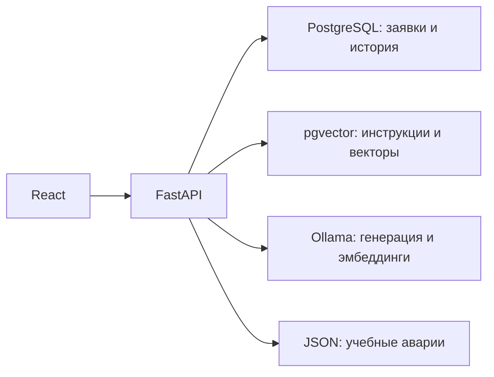

# Линия — AI-помощник техподдержки

[](https://github.com/vitsgod/linia-ai-support/actions/workflows/ci.yml)

Учебный fullstack-проект: заявки пользователей, диагностика по базе знаний, проверка учебных аварий и подготовка черновика обращения. Разработан в рамках практического обучения; коммерческая эксплуатация не заявляется.

## Возможности

- Создание и просмотр заявок с серверной валидацией и хранением в PostgreSQL.
- RAG: смысловой поиск по 12 фрагментам четырёх учебных инструкций, ответ с источниками или уточнение при недостатке материалов.
- Проверка аварий напрямую или через одношаговый выбор инструмента моделью. Аргументы проверяются сервером, выполняется максимум один разрешённый вызов.
- Редактируемый черновик: модель предлагает текст, пользователь проверяет его и отдельно создаёт заявку.
- Постоянная история запросов помощника, результатов и ошибок.
- Docker Compose для запуска; workflow GitHub Actions для проверки сборки и тестов.

## Стек и устройство

React + TypeScript + Vite → FastAPI/Pydantic → PostgreSQL с pgvector. Python обращается к локальной Ollama: Qwen3:4b генерирует ответы, Qwen3-Embedding:0.6b создаёт векторы размерности 1024.



История хранится в БД, но автоматически в контекст модели не добавляется. Для RAG приложение вычисляет вектор вопроса, находит подходящие фрагменты и передаёт их текст генеративной модели. Ответ проверяется по схеме и допустимым идентификаторам источников; отдельные правила отслеживают известные повторные советы.

## Быстрый запуск в Windows

Нужны Docker Desktop с Linux containers, PowerShell и работающая Ollama на компьютере с моделями `qwen3:4b` и `qwen3-embedding:0.6b`. Модели не включены в образ. Подготовка моделей описана в [local-model-setup.md](docs/local-model-setup.md) и [embedding-setup.md](docs/embedding-setup.md).

Из папки проекта:

```powershell
.\run-docker.ps1
```

Открыть http://127.0.0.1:5180; API-документация — http://127.0.0.1:5180/docs. Первый запуск требует интернета для загрузки образов и зависимостей. Скрипт собирает клиент и сервер, подготавливает БД и индексирует инструкции.

```powershell
.\run-docker.ps1 -Stop
```

Остановка сохраняет данные. Следующий запуск выполняется без `-Stop`. Docker-версия использует отдельную базу и не переносит записи прежней установки автоматически. Пароли хранятся в исключённом из Git `.local/docker-stack/stack.env`; не удаляйте этот файл и рабочий volume. Подробности: [Docker и CI](docs/docker-ci.md).

## Проверка

```powershell
.\check-docker.ps1
```

Создаётся отдельная тестовая база. Проверяются backend, клиент, TypeScript и production-сборка; временные ресурсы удаляются после завершения. Последняя проверка реализации: 76 backend-тестов и 21 клиентский тест; дополнительно проверены реальные запросы к Ollama, интерфейс и сохранность данных после пересоздания контейнеров. Модельные проверки не заменяются unit-тестами и не гарантируют одинаковый текст ответа.

Workflow `.github/workflows/ci.yml` подготовлен. Статус облачных проверок доступен на вкладке Actions репозитория. Публичное развёртывание приложения пока не выполнено.

## Что показать при демонстрации

[Сценарий на 5–7 минут](docs/demo.md): создание заявки, RAG с источником, учебные аварии, черновик с подтверждением и сохранность истории.

[Карточка для портфолио](docs/portfolio.md) содержит краткое описание и темы для обсуждения на собеседовании.

## Ограничения

- Это локальный учебный прототип без авторизации и разграничения доступа к заявкам/истории; не предназначен для публикации с реальными персональными данными.
- Аварии вымышлены и читаются из JSON, интеграции с провайдером нет.
- Маленькая база знаний и порог близости не обеспечивают универсальную точность. Возможны неточные ответы; ссылки на источники не доказывают каждый вывод модели.
- Нет автономного создания заявок, многошагового агентного цикла, памяти диалога и автоматического возобновления незавершённых операций.
- Скорость зависит от компьютера и загрузки моделей. Для Linux может потребоваться явно настроить доступный из контейнера адрес Ollama.

## Навигация по коду

| Путь | Ответственность |
|---|---|
| `frontend/src/` | Форма, заявки, результаты помощника и история |
| `backend/main.py`, `schemas.py` | HTTP API, входные и выходные схемы |
| `backend/rag.py`, `vector_store.py`, `embeddings.py` | Поиск материалов и ответ по контексту |
| `backend/outage_assistant.py`, `outages.py` | Выбор инструмента и фактические статусы |
| `backend/ticket_draft.py`, `history.py` | Черновики и журнал операций |
| `knowledge/`, `data/demo_outages.json` | Учебные источники |
| `tests/`, `frontend/src/api.test.ts` | Автоматические проверки |

Подробности этапов: [RAG](docs/rag-answers.md), [качество](docs/rag-quality.md), [инструмент](docs/model-tool.md), [черновики](docs/ticket-draft.md), [история](docs/history.md). Прежние записи этапов обучения сохранены локально и не входят в публичный репозиторий.
